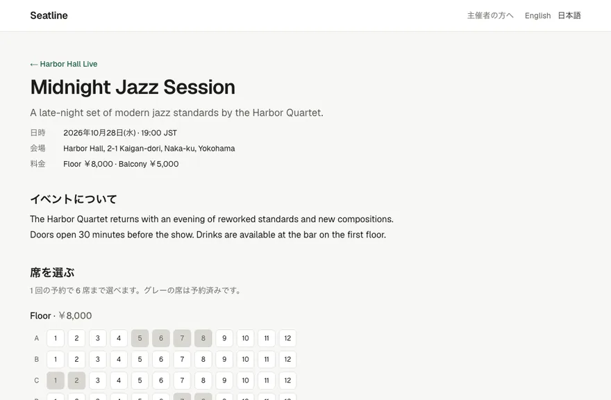
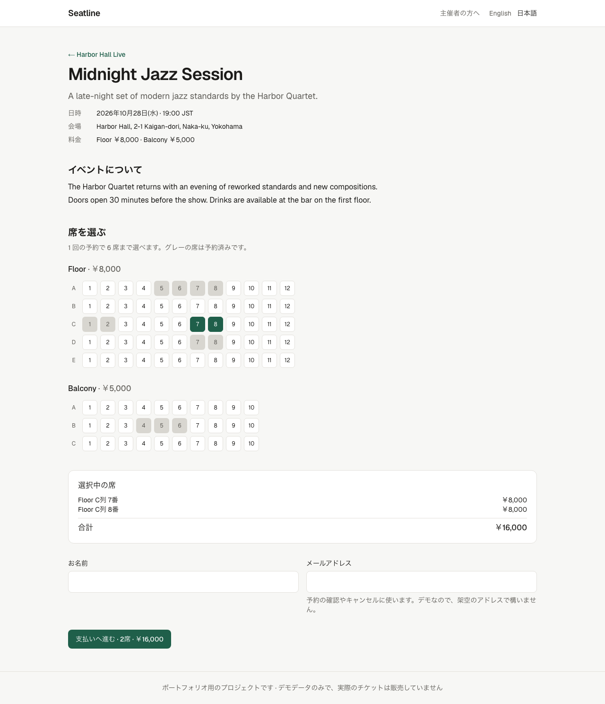
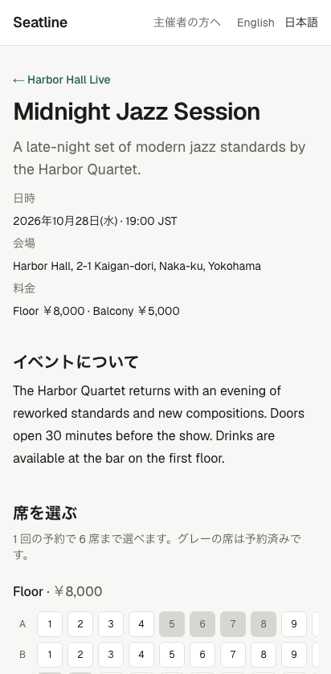
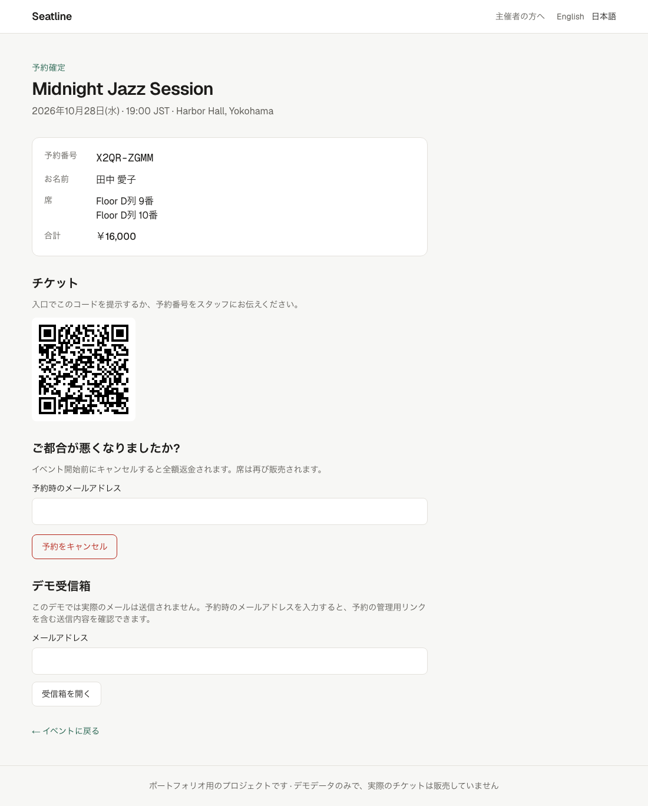
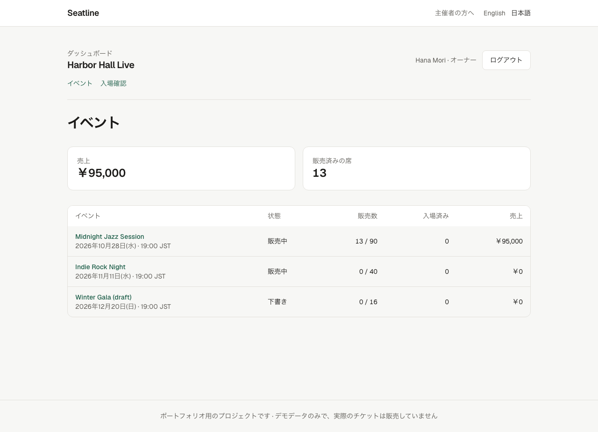
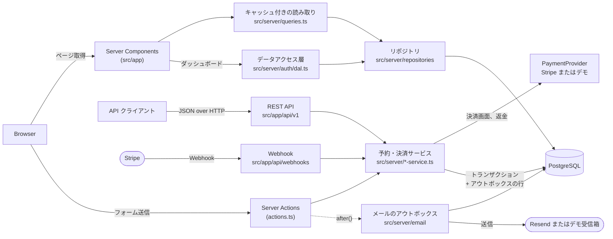
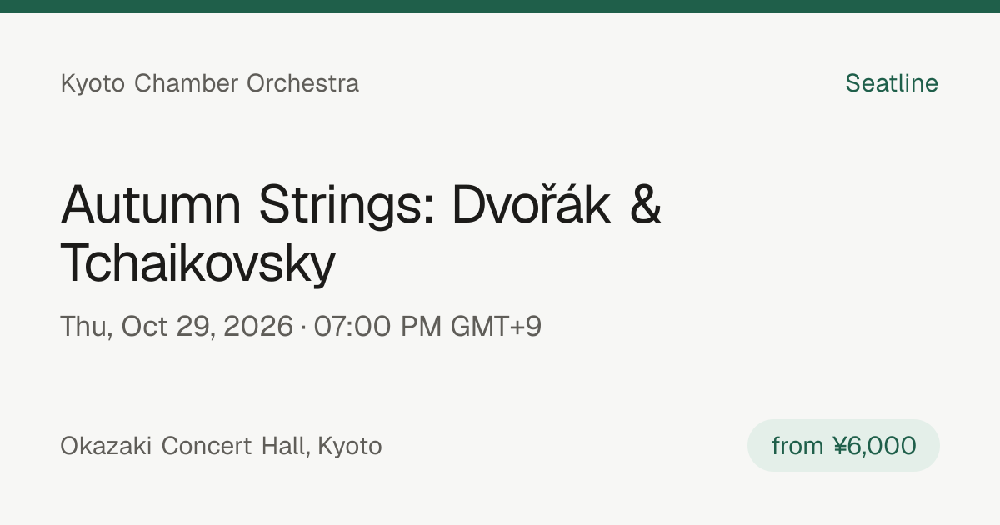

# Seatline — マルチテナント型 座席予約サービス

[](https://github.com/aliaksandr-yanchuk/event-booking-saas/actions/workflows/ci.yml)
[](LICENSE)

[English](README.md) | 日本語

ライブイベント向けの座席指定予約サービスです(ポートフォリオ用のプロジェクト)。
主催者(テナント)ごとにイベントページを持ち、来場者はリアルタイムの座席表から席を選びます。
決済の間は席が確保され、決済の完了で予約が確定します。**同じ席が二重に予約されることは、
同時にクリックしても起こりません。**

**デモ: [event-booking-saas.vercel.app](https://event-booking-saas.vercel.app)** ·
API: [`/api/v1/openapi.json`](https://event-booking-saas.vercel.app/api/v1/openapi.json)
(デモデータは毎週月曜にリセットされます。名前とメールアドレスは架空のもので構いません) ·
主催者ダッシュボード: [`/login`](https://event-booking-saas.vercel.app/login)(デモアカウントはログイン画面に表示)



<details>
<summary>その他のスクリーンショット: イベントページ、スマホ表示、チケット、主催者ダッシュボード</summary>









</details>

## このプロジェクトで示していること

| 分野                     | 内容                                                                                                                                |
| ------------------------ | ----------------------------------------------------------------------------------------------------------------------------------- |
| データ設計・バックエンド | Prisma 7 による PostgreSQL のスキーマ、テナント単位のリポジトリ、型付きの結果を返すトランザクション処理                             |
| 同時実行制御             | 二重予約を DB の制約で防止。10 件の同時リクエストで 1 件だけ成功することをテストで証明                                              |
| 認証・権限               | DB セッションと scrypt パスワードによる主催者ダッシュボード、オーナー / 受付スタッフの権限をデータアクセス層で判定、QR での入場確認 |
| 決済                     | 期限付きの座席確保、プロバイダーのインターフェース越しの決済、冪等な決済確定、期限後の入金と返金                                    |
| メール                   | トランザクショナル・アウトボックス、`after()` による応答後の送信、`SKIP LOCKED` での取得と再送、署名付きのワンクリック管理リンク    |
| REST API                 | RFC 9457 形式のエラー、適切なステータスコード、入力検証のスキーマから生成する OpenAPI を備えたバージョン付き JSON API               |
| フロントエンド           | Cache Components を使った Next.js 16 App Router、React 19 Server Actions、JavaScript なしでも動くアクセシブルなフォーム             |
| 多言語対応               | 英語と日本語: 型付きの辞書、英語の URL はそのままで `/ja` の URL を追加、`hreflang`、お客様の言語でのメール                         |
| SEO                      | イベントごとのメタデータ、canonical URL、生成した Open Graph 画像、schema.org `Event` の JSON-LD、sitemap と robots                 |
| テスト                   | Jest の単体テスト、実 DB に対する Jest の結合テスト、PC とスマホでの Playwright E2E、WCAG の自動チェック                            |
| デリバリー               | マルチステージの Docker イメージ、別ジョブとしてのマイグレーション、GitHub Actions CI                                               |

## 技術スタック

- **Next.js 16.4**(App Router、Cache Components、Partial Prefetching、standalone 出力)
- **React 19.3**、**TypeScript 5.9**、**Tailwind CSS 4**
- **PostgreSQL 17**、**Prisma 7**(`pg` ドライバーアダプター)
- 入力検証に **Zod 4**
- **Stripe**(Checkout、Webhook)と **Resend**(メール)。どちらも任意
- **Jest 30** + Testing Library、**Playwright**、**axe-core**、**stripe-mock**
- **Docker**、**GitHub Actions**、Node.js 24 LTS

## アーキテクチャ



Web ページと REST API は、同じサービス層への 2 つの入口です。ページは Server Components と
Server Actions を使い、ほかのクライアント(モバイルアプリ、提携先のシステム)は JSON API を使います。
予約のルールはサービスにしかないため、どちらから使っても同じように動きます。

- **ページ**は `app/[lang]` の下にある Server Components です。各ページは言語ごとに静的なシェルを事前レンダリングし、データに依存する部分は
  `<Suspense>` を通してストリーミングで届きます。ビルドにデータベースは不要です。
- **リポジトリ**にすべてのクエリがあります。読み取りは必ず `organizationId` を受け取るため、slug だけで
  イベントを取得する方法はなく、あるテナントが別のテナントのデータを見ることはありません。
- **キャッシュ:** イベントの詳細は数分、「残り席数」は数秒キャッシュします。予約の後は `updateTag` で
  残り席数を無効化します。座席表そのものはキャッシュしません。
- **Server Actions** は Zod で入力を検証し、予約サービスを呼び出し、その型付きの結果
  (`SEATS_TAKEN`、`TOO_MANY_SEATS` など)をフォームのメッセージに変換します。

## REST API

ベースパスは `/api/v1` です。仕様の全体は OpenAPI 3.1 として
[`/api/v1/openapi.json`](src/app/api/v1/openapi.json/route.ts) で配信しています。

**契約は一度だけ定義する。** リクエストとレスポンスの本文はすべて
[`src/server/api/schemas.ts`](src/server/api/schemas.ts) の Zod スキーマで、その 1 つの定義を
3 か所で使うため、ドキュメントとコードがずれることはありません。

1. **TypeScript:** シリアライザーとルートハンドラーは、スキーマとまったく同じ形を返す必要があります
   (`jsonResponse(EventDetailResponse, …)`)。仕様にないフィールド、たとえばお客様のメールアドレスを
   追加すると、コンパイルエラーになります。
2. **OpenAPI:** ドキュメントのスキーマは同じスキーマから生成します(`z.toJSONSchema`)。
   リクエストは "input" モード、レスポンスは "output" モードです。
3. **契約テスト:** API テストは実際のレスポンスをすべてスキーマで検証します。レスポンスのスキーマは
   厳格なので、フィールドの欠落・名前の変更・余分なフィールドはテストの失敗になります。

| メソッド | パス                                               | 成功時                                                                     | エラー                            |
| -------- | -------------------------------------------------- | -------------------------------------------------------------------------- | --------------------------------- |
| GET      | `/organizations/{org}/events`                      | 200、60 秒キャッシュ可能                                                   | 404                               |
| GET      | `/organizations/{org}/events/{event}`              | 200 とリアルタイムの座席表、`no-cache` + `ETag`(変更がなければ 304)        | 404                               |
| POST     | `/organizations/{org}/events/{event}/bookings`     | 201 + `Location`: 決済リンク付きの `pending_payment`、無料なら `confirmed` | 400, 404, 409, 415, 422, 429, 502 |
| GET      | `/organizations/{org}/bookings/{reference}`        | 200(レスポンスにメールアドレスは含まない)                                  | 404                               |
| POST     | `/organizations/{org}/bookings/{reference}/cancel` | 200: 確保を解放、または支払い済みの予約をキャンセルして返金                | 400, 404, 409, 422, 429           |

```bash
curl -s -X POST http://localhost:3000/api/v1/organizations/harbor-hall/events/midnight-jazz-session/bookings \
  -H 'Content-Type: application/json' \
  -d '{"customerName":"Aiko Tanaka","customerEmail":"aiko@example.com","seatIds":["evt_midnight-jazz-session_Floor_D1"]}'
```

エラーは RFC 9457 の Problem Details 形式で、変わらない `code` を持つため、クライアントは
メッセージの文面ではなくコードで分岐できます。

```json
{
  "type": "about:blank#SEATS_TAKEN",
  "title": "Some seats are already booked",
  "status": 409,
  "code": "SEATS_TAKEN",
  "detail": "Another customer booked these seats first.",
  "takenSeatIds": ["evt_midnight-jazz-session_Floor_D1"]
}
```

ステータスコードは一般的な使い分けに従います。**400** は本文が不正(フィールドごとの `errors` 付き)、
**409** は現在の状態との競合(席が予約済み、キャンセル済み)、**422** は形式は正しいが予約のルールに
反するリクエスト(席数の上限超え、受付終了)です。キャンセルは `DELETE` ではなく `POST …/cancel` です。
本文(本人確認としてのメールアドレス)が必要で、予約は削除せず `cancelled` の状態で残すためです。

**安全なリトライ。** `POST …/bookings` は
[`Idempotency-Key`](https://datatracker.ietf.org/doc/draft-ietf-httpapi-idempotency-key-header/)
ヘッダーを受け付けます。予約のレスポンスが失われた場合(タイムアウト、モバイル回線の切断)、
クライアントが同じキーで同じリクエストを再送すると、新しい予約や分かりにくい `409` ではなく、
`Idempotent-Replayed: true` の付いた最初の `201` がそのまま返ります。

```bash
curl -s -X POST …/bookings -H 'Idempotency-Key: "8e03978e-40d5-43e8-bc93-6894a57f9324"' …
```

同じキーを別のリクエスト(別の席や別のお客様)に使うのはクライアントのバグなので、
`422 IDEMPOTENCY_KEY_REUSED` を返します。

**レート制限。** 予約とキャンセルはクライアントのアドレスごとに、キャンセルは予約ごとにも制限しています。
上限を超えると API は `Retry-After` 付きの `429 RATE_LIMITED` を返し、フォームには
「N 分後にもう一度お試しください」と表示します。

## 設計判断

採用しなかった案も含めた記録の全体は [`docs/decisions.md`](docs/decisions.md)(英語)にあります。

**二重予約は仕組みとして起こらない。** `booking_seats.seat_id` に一意制約があります。サービスは
分かりやすいエラーのために先に空きを確認しますが、正しさはこの確認に依存しません。2 件のリクエストが
同時に確認を通っても、PostgreSQL が 2 件目の INSERT を拒否し、そのトランザクション全体がロールバックされます。
結合テスト [`booking-service.int.test.ts`](src/server/booking-service.int.test.ts) は 1 つの席に
10 件の予約を同時に送り、ちょうど 1 件だけが成功し、中途半端な行が残らないことを確認しています。

**決済の間、席を確保する。** 有料の予約は `PENDING` として始まり、売れた予約と同じように
`booking_seats` の行を持つため、確保中の席も同じ一意制約で守られます。確保期間は 35 分です。
決済画面は 30 分(Stripe の最短)で閉じ、残りの数分があることで、最後の瞬間に支払っても席が残っています。
期限切れの確保は、その席を予約しようとする次のトランザクションの中で(またはプロバイダーからの
「決済画面の期限切れ」の通知で)遅延的に解放されるため、正しさのためのバックグラウンド処理は不要です。
それまでの間も、すべての読み取りは期限切れの確保を無視します。決済の確定は冪等です。状態の遷移はすべて
`UPDATE … WHERE status = <期待する状態>` なので、Webhook・戻り先のページ・リトライのどこから同じ決済が
報告されても安全です。確保の期限後に届いた入金は、席がまだ空いていれば席を取り戻し、そうでなければ
返金します([`payment-service.ts`](src/server/payment-service.ts))。これらの経路はすべて結合テストで
確認しており、期限後の入金と新しいお客様が同じ席を奪い合うケースも含みます。

```
PENDING ──paid──▶ CONFIRMED ──cancel──▶ CANCELLED (refunded)
   ├──cancel──▶ CANCELLED
   └──hold expired──▶ EXPIRED ──paid late──▶ CONFIRMED (seats still free) or REFUNDED
```

決済は小さな `PaymentProvider` インターフェース([`provider.ts`](src/server/payments/provider.ts))の
向こう側にあります。Stripe のキーがあれば Stripe Checkout
([`stripe-provider.ts`](src/server/payments/stripe-provider.ts))を使います。Webhook は生の本文で
Stripe の署名を検証し、お客様が戻ってくるページでも Stripe にセッションの状態を問い合わせるため、
Webhook が遅れても、支払ったお客様に「支払い待ち」と表示されることはありません。キーがない場合
(ローカル、CI、デモ)は、内蔵のデモ決済画面が代わりになります。その「支払う」ボタンは Webhook と同じ
`confirmPayment()` を呼ぶため、E2E テストは決済後の処理を本番と同じコードで実行します。Stripe の
アダプター自体は、Stripe 公式のモックサーバー [stripe-mock](https://github.com/stripe/stripe-mock)
に対してテストしています。stripe-mock は Stripe の API に合わないリクエストをすべて拒否します。

**冪等キーは、席の制約とは別の問題を解決する。** 制約だけでも、再送されたリクエストが二重に予約することは
ありません。しかし再送は `SEATS_TAKEN` で失敗します。サーバーから見ると、お客様自身の最初の試みが席を
確保しているからです。キーがあれば、サーバーは再送だと分かり、最初の予約を返せます。キーは予約と同じ
トランザクションで保存する(`idempotency_keys`、テナントとキーの主キーに加えてリクエストの SHA-256)ため、
クラッシュ後に片付けるべき「処理中」の状態はありません。予約とキーが両方あるか、どちらもないかのどちらかです。
失敗したリクエストは何も保存しないので、そのまま再試行できます。同じキーの 2 件のリクエストが同時に来た場合は、
席の競合と同じ制約で処理し、負けた側は勝った側の予約を探して返します。予約フォームも、ページ表示ごとの
隠しキーで同じ仕組みを使うため、JavaScript なしでの二度押しでも予約は 1 件になります。

**テナントの分離は、ページではなくデータ層で行う。** イベントの slug は主催者ごとに一意で
(`@@unique([organizationId, slug])`)、席の ID は必ずそのイベントの中で検索し、別のイベントや
テナントの席の ID は拒否します(`INVALID_SEATS`)。

**Server Action の引数はサーバー側で束縛する。** 主催者とイベントの slug は `.bind()` で渡し、
Next.js がそれを暗号化するため、クライアントがリクエストを書き換えて予約を別のテナントのイベントに
向けることはできません。

**英語と日本語に対応し、英語の URL は 1 つも変えない。** すべてのページは `app/[lang]` の下にあり、
言語ごとに静的なシェルを持ちます。日本語の URL は `/ja` で始まり、[`proxy.ts`](src/proxy.ts) が
プレフィックスのない URL を内部で `/en` に書き換えるため、日本語に対応する前に共有されたリンクも
そのまま動きます。文言は型付きの辞書([`src/i18n`](src/i18n))から取得します。日本語の辞書は英語の辞書と
同じ型なので、翻訳漏れはコンパイルエラーになります。Server Components は、言語をすべてのコンポーネントに
渡すのではなく `next/root-params` で読み取ります。クライアントコンポーネントには、辞書全体ではなく
表示する文言だけを渡します。日付と金額はページのロケールで `Intl` を使って表示します
(`2026年10月28日(水) · 19:00 JST`、`￥8,000`)。予約は言語を記録するため、席の表示、メール、
署名付きリンク、Stripe Checkout もその言語になります。各ページには `hreflang` の代替リンクがあり、
sitemap には両方の言語を載せています。主催者のコンテンツ(イベント名や説明)は主催者が書いたまま表示し、
Open Graph のカードは英語のままです。日本語を描画するには CJK フォントを同梱する必要があるためです。

**フォームは JavaScript なしでも動く。** 席は座席の見た目にした本物の `<input type="checkbox">` なので、
キーボード操作、スクリーンリーダー、普通の HTML フォーム送信がそのまま動きます。エラーは
`aria-describedby` と `aria-invalid` で各フィールドに結び付けています。

**座席表を、低コストでリアルタイムに保つ。** ページを開いている間、公開されているイベント API を 5 秒ごとに
ポーリングする([`use-live-taken-seats.ts`](src/components/use-live-taken-seats.ts))ため、ほかの人が
予約した席はグレーになり、キャンセルされた席は再読み込みなしで空きに戻ります。来場者が選んでいた席が
予約された場合は、送信時に失敗させるのではなく、お知らせ(スクリーンリーダーにも読み上げ)とともに選択から
外します。WebSocket や SSE ではなくポーリングにしたのは、サーバーレス環境ではストリームが来場者ごとに
関数を動かし続けるからです。API は `Cache-Control: no-cache` とともに `ETag` を返すため、ブラウザは
毎回のポーリングで再検証し、座席表に変化がなければ空の `304` で済みます。タブが非表示の間はポーリングを
止めます。ページは、ほかのクライアントと同じ公開 API を使っています。

**共有されたリンクにはプレビュー画像を付ける。**
[`opengraph-image.tsx`](src/app/[org]/events/[event]/opengraph-image.tsx) が `ImageResponse`
(JSX を PNG にレンダリング)でイベントごとに 1200×630 のカードを描画し、Next.js がページに
`og:image` / `twitter:image` のタグを追加します。カードには、めったに変わらない情報だけを載せています。
各サービスはプレビューを何日もキャッシュするため、「残り席数」はすぐに不正確になるからです。



**主催者にはダッシュボードがあり、権限はデータのそばで確認する。** オーナーは、イベントごとの売上、
収益、お客様のメールアドレス付きのすべての予約、CSV エクスポートを見られます。受付スタッフは、
メールアドレスなしの来場者リストを見て、入場確認ができます。すべてのページ、Server Action、
Route Handler がデータアクセス層([`dal.ts`](src/server/auth/dal.ts))を呼び出します。データアクセス層は
セッション Cookie をユーザーに、URL の主催者を所属情報(メンバーシップ)に変換し、ダッシュボードの
クエリはすべて、URL ではなくこの所属情報から主催者 ID を受け取ります。所属していないユーザーには、
存在しない主催者と同じ 404 を返します。[`proxy.ts`](src/proxy.ts) は、セッション Cookie のない
リクエストをログイン画面へ送るだけです。プリフェッチを含むすべてのリクエストの前に動くため、
データベースは参照しません。お客様の予約ページには、その予約の入場確認ページを開く QR コードを表示し、
スタッフはスマホのカメラでチケットを読み取ります。入場確認は「まだ入場していない」ことを条件にするため、
1 枚のチケットで二度入場することはできません。

**セッションは署名付き Cookie ではなく、DB の行。** Cookie には 256 ビットの乱数が入り、データベースには
その SHA-256 だけを保存します。ログアウトすると行を削除するため、サーバー側のセッションもすぐに終わります
(ログアウト後に古い Cookie を戻して、拒否されることを確認するテストがあります)。パスワードは Node の標準
ライブラリの scrypt でハッシュ化します。存在しないメールアドレスでのログインでもハッシュ計算を行うため、
応答時間からアカウントの有無は分かりません。失敗したログインはアカウントごとに、すべての試行はアドレスごとに
制限します。成功したログインはアカウントごとの回数に数えません。全員がデモアカウントを共有しているからです。
`next` パラメーターはダッシュボードのパスしか受け付けないため、ログイン画面をオープンリダイレクトに使う
ことはできません。

**メールはトランザクショナル・アウトボックスを通す。** 予約の変更とそのメールは 1 つのトランザクションで
書き込みます([`outbox.ts`](src/server/email/outbox.ts))。確定した予約には必ず確認メールが届き、
競合に負けた予約からは送られません。送信はレスポンスを返した後(Next.js の `after()`)に行うため、
お客様がメールサービスを待つことはありません。各回の送信処理は `FOR UPDATE SKIP LOCKED` でメッセージを
取得するため、処理が重なっても同じメールを送ることはなく、失敗した送信は後の回で再試行します。その際は
メッセージ ID をメールサービスの冪等キーにします。本文は送信時にレンダリングするため、設定の問題があっても
メールが遅れるだけです。Resend のキーがあればメールを送信し、ない場合は予約ページのデモ受信箱で、
送られた内容を確認できます。受信箱はキャンセルと同じメールアドレスの確認の後ろにあります。

**メールのリンクなら、メールアドレスを入力せずにキャンセルできる。** キャンセルには、本人確認として
予約時のメールアドレスが必要です。そのアドレスに届いたリンクは同じことを証明するため、確認メールには
ワンクリックのキャンセルページへの署名付きリンク(予約 ID・メールアドレス・有効期限の HMAC、
イベント開始まで有効)が入っています。トークンは Server Action の中でも再検証し、書き換えられた
トークンは拒否します(単体テストと E2E テストで確認)。

**予約ページは非公開。** 予約番号は暗号論的に安全な乱数生成器から作り(31⁸ 通り)、確認ページは
`noindex` でメールアドレスを表示せず、キャンセルには予約番号に加えてメールアドレスが必要です。

**レート制限は PostgreSQL に置く。** カウンターは 1 つのテーブルで、確認ごとにアトミックな
`INSERT … ON CONFLICT DO UPDATE` を 1 回実行します([`rate-limit.ts`](src/server/rate-limit.ts))。
そのため、すべてのサーバーインスタンスが同じカウンターを共有し、デモに Redis は不要です。結合テストでは
20 件を同時に送り、ちょうど上限の数だけが通ることを確認しています。特に重要なのは、キャンセルの予約ごとの
制限です。そこではメールアドレスが秘密情報なので、多数のアドレスからでもメールアドレスの推測を止めます。
クライアントのアドレスは `X-Forwarded-For` から取得します。Vercel はこのヘッダーを上書きするため、
クライアントが偽装することはできません。自前でホストする場合は、同じことをするプロキシが必要です。
E2E テストでは各テストに専用のアドレスを割り当て、テスト同士で上限を使い合わないようにしています。

**静的レンダリングを諦めずにセキュリティヘッダーを付ける。** すべてのレスポンスに Content Security Policy、
HSTS、`nosniff`、厳格なリファラーポリシーを付けています([`next.config.ts`](next.config.ts))。CSP は
nonce を使いません。nonce はリクエストごとに変える必要があるため、すべてのページをリクエストごとに
レンダリングすることになり、Cache Components の事前レンダリングされたシェルが使えなくなるからです。
代わりに、同一オリジンのリソースだけを許可し、プラグイン、`<base>` の変更、フレームへの埋め込み、
他サイトへのフォーム送信をブロックし、Next.js が静的シェルにペイロードをインラインで埋め込むため、
スクリプトには `'unsafe-inline'` を残しています。E2E テストが予約の流れを一通り操作し、CSP 違反が
1 つでもあれば失敗します。

**金額は最小通貨単位で保存する**(`priceMinor: Int`)。`Intl.NumberFormat` で表示するため、
日本円でも米ドルでも浮動小数点の誤差なく扱えます。

## テスト

| 種類             | コマンド                            | 内容                                                                                                                                           |
| ---------------- | ----------------------------------- | ---------------------------------------------------------------------------------------------------------------------------------------------- |
| 単体             | `npm test`                          | 料金、入力検証、予約番号、JSON-LD、パスワード、署名付きリンク、CSV、メールテンプレート、リアルタイム座席表付きの予約フォーム、Webhook のルート |
| 結合             | `npm run test:integration`          | PostgreSQL に対する予約・決済サービス: 競合、確保、期限後の入金、返金、テナント分離、レート制限。stripe-mock に対する Stripe アダプター        |
| E2E              | `npm run test:e2e`                  | 英語と日本語での予約・決済・解放・返金・メール・ダッシュボードの操作。Chromium で PC とスマホの画面サイズ、本番ビルドに対して実行              |
| API              | `npm run test:e2e -- --project=api` | 実際の HTTP での REST API の契約: ステータスコード、ヘッダー、Problem Details、同時予約、テナント分離                                          |
| アクセシビリティ | `npx playwright test accessibility` | axe-core による全ページ種別の WCAG 2.2 A/AA チェック。ライト・ダークモードの両方、エラー表示中のフォームも含む                                 |

CI はプルリクエストごとにこれらすべてを実行し、加えて lint、フォーマット、型チェック、Docker ビルドを行います。
CI の E2E テストは本番ビルド(`node .next/standalone/server.js`)に対して実行します。

### 開発中にテストが見つけた不具合

1. **フォームのリセットで席の選択が消えた。** React は `<form action>` のアクションが終わると
   フォームをリセットします。送信が失敗した後、座席のチェックボックスは外れたのに、選択内容の欄には
   席が残っていたため、次の送信では席が 1 つも送られないところでした。
   [`submit-without-reset.ts`](src/lib/submit-without-reset.ts) で修正し、回帰テストを追加しました。
2. **スマホでページが画面より広くなった。** `<fieldset>` の初期値は `min-inline-size: min-content` なので、
   座席の列が枠の中でスクロールせずにページ全体を引き伸ばしていました。気付いたのはスマホの E2E だけでした。
3. **`next dev` での無限リロード。** プロジェクトのテンプレートにあった `@tailwindcss/turbopack` ローダーが、
   各ページを何百回も再読み込みさせていました。現在はドキュメントどおりの `@tailwindcss/postcss` を使っています。
4. **再シード後に古いキャッシュが残った。** 起動中のサーバーの裏で再シードすると、キャッシュされたページが
   削除済みの行を指していました。シードは固定の ID を使うようにしました。
5. **二度押しで、お客様自身の予約に「予約済み」と返ることがあった。** 座席の確保でトランザクションが少し
   長くなったところで、冪等キーの同時実行テストが失敗し始めました。重複したリクエストが、最初のリクエストの
   コミット前にキーを確認し、その後で席が埋まっているのを見ていたためです。現在は `SEATS_TAKEN` を返す前に
   もう一度キーを確認します。
6. **API が、決済画面の作成で延長される前の確保期限を返していた。** API テストが予約レスポンスの
   `expiresAt` と予約そのものを比較し、14 ミリ秒のずれを見つけました。
7. **Partial Prefetching がセッションの確認を拒否した。** E2E のサーバーログに、ダッシュボードの App Shell を
   事前レンダリングする際に Next.js が `new Date()` を拒否したと出ていました。現在、セッションの確認は
   `connection()` で事前レンダリングの対象外にしています。

### パフォーマンス

イベントページの Lighthouse の結果です(本番ビルド、Lighthouse 12 の既定値。モバイルは低速 4G と
中程度のスマホを模擬)。

| 端末     | Performance | Accessibility | Best practices | SEO | LCP   | CLS | TBT   |
| -------- | ----------- | ------------- | -------------- | --- | ----- | --- | ----- |
| モバイル | 97          | 100           | 100            | 91  | 2.7 s | 0   | 50 ms |
| PC       | 100         | 100           | 100            | 91  | 0.6 s | 0   | 0 ms  |

SEO が 91 なのは、メタデータのストリーミングによるものです。Next.js 16 は `generateMetadata` の完了まで
ページを止めず、JavaScript を実行するクライアント(Googlebot を含む)には `<body>` の末尾にタグを追加し、
実行できないクローラー(Slack、Facebook)には `<head>` に入れて返します。Lighthouse は `<head>` しか
見ません。ストリーミングを止めると、実際の利点をスコアと引き換えにすることになります。レイアウトシフトは、
`<main>` に 1 画面分の最小の高さを付ける前は 0.084 でした。ストリーミングで届いたイベントの内容が、
それより短いスケルトンと入れ替わるときに、フッターが動いていたためです。

## デプロイ

デモは **Vercel**(アプリ)と **Neon**(サーバーレス PostgreSQL)で動いています。同じコードは、
Docker イメージとして任意のコンテナ基盤でも動きます。

- `vercel-build` は `next build` の前に未適用のマイグレーションを適用します(`prisma migrate deploy`)。
- アプリは Neon のプーリング用 URL(`DATABASE_URL`)で接続し、Prisma CLI は直接接続の URL
  (`DATABASE_URL_UNPOOLED`)を使います。マイグレーションにはプーリングしない接続が必要だからです。
- canonical URL とプレビュー画像には `SITE_URL` を使い、未設定の場合は Vercel の本番ドメインを使います。
- 定期実行のワークフロー([`reset-demo.yml`](.github/workflows/reset-demo.yml))が毎週月曜にデモの
  データベースを再シードするため、イベントは常に開催前で、来場者の予約は消去されます。

### シークレットと任意のサービス

- `BOOKING_LINK_SECRET`(**本番では必須**): メール内のリンクに署名します。`openssl rand -base64 32` で
  生成してください。ない場合はメールを送れません(予約は動き、キューに入ったメールは設定後に送られます)。
- `RESEND_API_KEY` と `EMAIL_FROM`(任意): デモ受信箱の代わりに Resend でメールを送ります。
  Resend には認証済みの送信ドメインが必要です。

### Stripe(任意)

Stripe のキーがない場合は、デモ決済画面を使います。Stripe Checkout でテスト決済を受け付けるには:

1. Stripe のダッシュボード(テストモード)で、`https://<あなたのドメイン>/api/webhooks/stripe` に
   Webhook のエンドポイントを追加し、イベント `checkout.session.completed`、
   `checkout.session.async_payment_succeeded`、`checkout.session.async_payment_failed`、
   `checkout.session.expired` を選びます。
2. Vercel のプロジェクトに `STRIPE_SECRET_KEY`(テスト用のキー。本番用のキーは拒否します)と
   `STRIPE_WEBHOOK_SECRET`(エンドポイントの署名シークレット)を設定し、再デプロイします。
3. Stripe のテストカード `4242 4242 4242 4242`、未来の任意の日付、任意の CVC で支払います。

ローカルでは、`stripe listen --forward-to localhost:3000/api/webhooks/stripe` が表示する Webhook の
シークレットを代わりに使います。

## ローカルでの起動

必要なもの: Node.js 24(`nvm use`)、Docker

```bash
npm install
cp .env.example .env
npm run db:up            # Docker で PostgreSQL(テスト用 DB も作成)と stripe-mock を起動
npx prisma migrate deploy
npm run db:seed          # デモ用の主催者 2 件とイベント
npm run dev              # http://localhost:3000
```

テスト:

```bash
npm test                 # 単体
npm run test:integration # `npm run db:up` のデータベースが必要
npx playwright install chromium
npm run test:e2e         # 先に開発用データベースを再シードします
```

本番に近い構成を Docker で(アプリの起動前に、マイグレーションを 1 回限りのジョブとして実行):

```bash
docker compose --profile app up --build
```

### スクリーンショット

`docs/`(英語)と `docs/ja/`(日本語。この README で使用)の画像は、シードしたばかりのデータと
本番ビルドに対して [`scripts/capture-docs.mjs`](scripts/capture-docs.mjs) を実行して作っているため、
UI を変えた後に作り直せます。

## プロジェクト構成

```
prisma/                  スキーマ、マイグレーション、デモ用シード
src/app/[lang]/          言語ごと(en、ja)のページと Server Actions
src/app/[lang]/dashboard/ 主催者ダッシュボード(イベント、予約、CSV エクスポート、入場確認)
src/app/[lang]/checkout/demo/ Stripe のキーがないときに使うデモ決済画面
src/app/api/v1/          REST API のルートハンドラーと OpenAPI ドキュメント(英語)
src/i18n/                言語、URL のヘルパー、英語と日本語の辞書
src/server/api/          Problem Details のレスポンスと API のシリアライザー
src/components/          予約フォーム、キャンセルフォーム、UI の基本部品
src/lib/                 純粋関数(金額、日付、入力検証、JSON-LD)と単体テスト
src/server/              DB クライアント、リポジトリ、予約・決済サービス、キャッシュ付きの読み取り
src/server/auth/         パスワード、セッション、データアクセス層
src/server/payments/     決済プロバイダーのインターフェース、Stripe とデモの実装、Webhook の処理
src/server/email/        アウトボックス、テンプレート、送信の実装、署名付きの管理リンク
src/proxy.ts             言語のルーティング(英語はプレフィックスなし)と、ダッシュボードのログインへのリダイレクト
test/integration/        DB テストの準備とファクトリー
e2e/                     Playwright のテスト
scripts/                 ドキュメント用のスクリーンショット撮影
```

## AI の活用について

このプロジェクトは Claude Code をペアプログラマーとして使って開発しました。[AGENTS.md](AGENTS.md) には、
このリポジトリでエージェントが従うルールがあります。API を使う前に同梱の Next.js 16 のドキュメントを読む、
クエリは必ずテナントで絞り込む、振る舞いはテストで証明する、などです。すべての変更をレビューし、上に挙げた
不具合は、生成されたコードを正しいと決めつけるのではなく、テストを実行して見つけ、原因を特定したものです。

## 今後の改善案

- 主催者アカウントの登録、招待、パスワードの再設定(アカウントをシードで作らなくなった段階で、
  Better Auth などのライブラリを使う)
- どのリクエストにも拾われなかったメールを送る定期ジョブ(現在は後のリクエストが送るため、
  一定のアクセスがあるデモでは十分)
- シードの代わりに、主催者がイベントと座席表を作る機能
- イベントのコンテンツの多言語化(現在、主催者は 1 つの言語で入力します)
