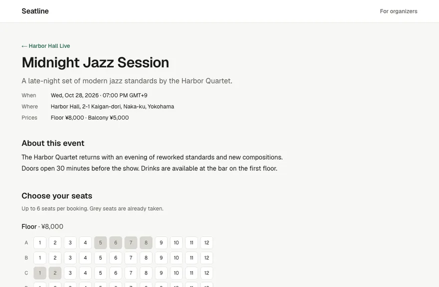
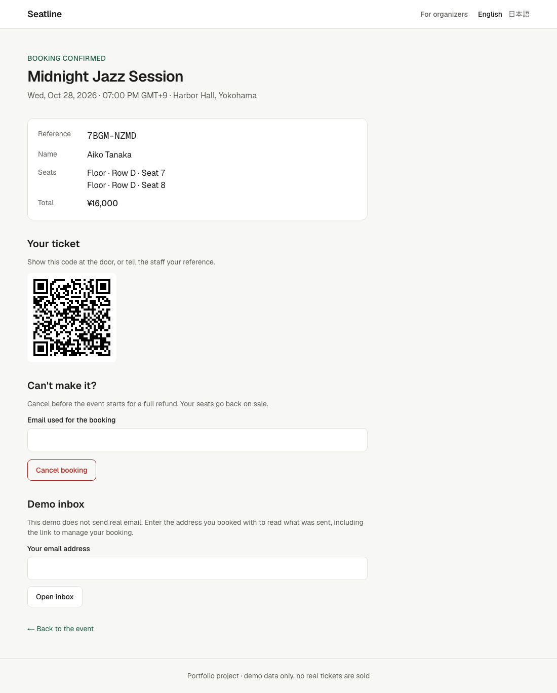
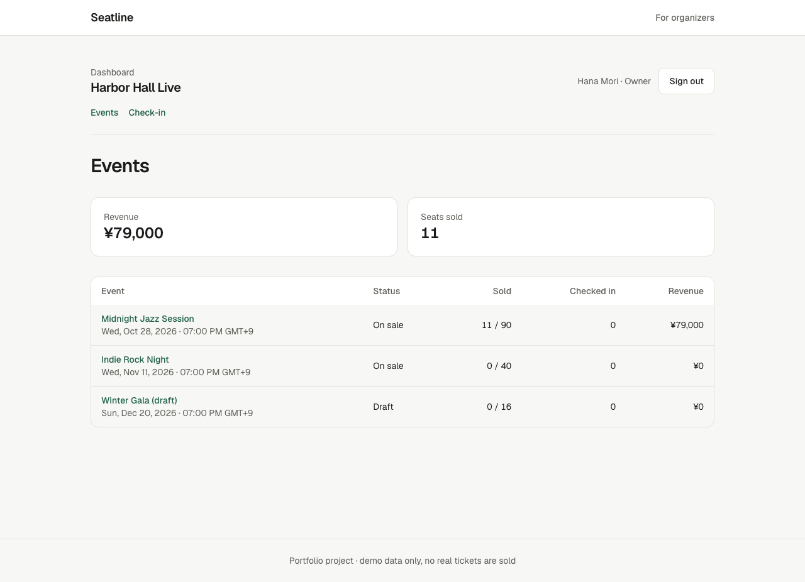
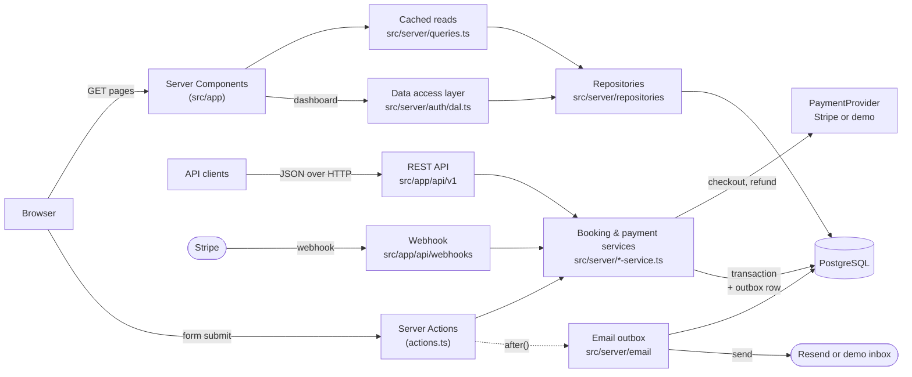

# Seatline — multi-tenant event booking

[](https://github.com/aliaksandr-yanchuk/event-booking-saas/actions/workflows/ci.yml)
[](LICENSE)

English | [日本語](README.ja.md)

A reserved-seating booking service for live events, built as a portfolio project.
Each organizer (tenant) gets its own event pages; visitors pick seats on a live seat map,
the seats are held while they pay, and the payment confirms the booking. **Two people can
never book the same seat**, even when they click at the same moment.

**Live demo: [event-booking-saas.vercel.app](https://event-booking-saas.vercel.app)** ·
API: [`/api/v1/openapi.json`](https://event-booking-saas.vercel.app/api/v1/openapi.json)
(demo data, reset every Monday; use any made-up name and email) ·
Organizer dashboard: [`/login`](https://event-booking-saas.vercel.app/login), demo accounts listed there



<details>
<summary>More screenshots: event page, phone, ticket, organizer dashboard</summary>






</details>

## What it shows

| Area                    | In this project                                                                                                                      |
| ----------------------- | ------------------------------------------------------------------------------------------------------------------------------------ |
| Backend & data modeling | PostgreSQL schema with Prisma 7, tenant-scoped repositories, transactional booking service with typed results                        |
| Concurrency             | Double booking prevented by a database constraint, proven by a test that fires 10 simultaneous requests                              |
| Auth & roles            | Organizer dashboard with database sessions, scrypt passwords, owner and door-staff roles checked in a data access layer, QR check-in |
| Payments                | Seat holds that expire, a checkout behind a provider interface, idempotent payment confirmation, late payments and refunds           |
| Email                   | Transactional outbox, delivery after the response with `after()`, `SKIP LOCKED` claims and retries, signed one-click manage links    |
| REST API                | Versioned JSON API with RFC 9457 error responses, correct status codes and an OpenAPI document generated from the validation schema  |
| Frontend                | Next.js 16 App Router with Cache Components, React 19 Server Actions, accessible forms that also work without JavaScript             |
| SEO                     | Per-event metadata, canonical URLs, generated Open Graph images, schema.org `Event` JSON-LD, sitemap and robots                      |
| Testing                 | Jest unit tests, Jest integration tests against a real database, Playwright E2E on desktop and mobile, automated WCAG checks         |
| Delivery                | Multi-stage Docker image, migrations as a separate job, GitHub Actions CI                                                            |

## Tech stack

- **Next.js 16.4** (App Router, Cache Components, Partial Prefetching, standalone output)
- **React 19.3**, **TypeScript 5.9**, **Tailwind CSS 4**
- **PostgreSQL 17**, **Prisma 7** (with the `pg` driver adapter)
- **Zod 4** for validation
- **Jest 30** + Testing Library, **Playwright**
- **Docker**, **GitHub Actions**, Node.js 24 LTS

## Architecture



The web pages and the REST API are two entry points into the same service layer:
the pages use Server Components and Server Actions, while other clients (a mobile app,
a partner integration) use the JSON API. Booking rules live only in the service, so
both behave the same.

- **Pages** are Server Components. Each page prerenders a static shell, and the
  data-dependent parts stream in through `<Suspense>`. The build needs no database.
- **Repositories** hold all queries. Every read takes an `organizationId`, so there is
  no way to fetch an event by slug alone, and one tenant can never see another's data.
- **Caching:** event details are cached for minutes, the "seats left" count for seconds.
  After a booking, `updateTag` invalidates the count. The seat map itself is never cached.
- **Server Actions** validate input with Zod, call the booking service, and map its
  typed results (`SEATS_TAKEN`, `TOO_MANY_SEATS`, …) to messages for the form.

## REST API

Base path `/api/v1`. The full description is served as OpenAPI 3.1 at
[`/api/v1/openapi.json`](src/app/api/v1/openapi.json/route.ts).

**One contract, defined once.** Every request and response body is a Zod schema in
[`src/server/api/schemas.ts`](src/server/api/schemas.ts), and that single definition is
used in three places, so the documentation cannot drift from the code:

1. **TypeScript:** serializers and route handlers must return exactly the schema's
   shape (`jsonResponse(EventDetailResponse, …)`). Adding an undocumented field, for
   example the customer's email, is a compile error.
2. **OpenAPI:** the document's component schemas are generated from the same schemas
   (`z.toJSONSchema`), requests in "input" mode and responses in "output" mode.
3. **Contract tests:** the API tests parse every real response with its schema. The
   response schemas are strict, so a missing, renamed or extra field fails the test.

| Method | Path                                               | Success                                                                          | Errors                            |
| ------ | -------------------------------------------------- | -------------------------------------------------------------------------------- | --------------------------------- |
| GET    | `/organizations/{org}/events`                      | 200, cacheable for 60 s                                                          | 404                               |
| GET    | `/organizations/{org}/events/{event}`              | 200 with live seat map, `no-cache` + `ETag` (304 when unchanged)                 | 404                               |
| POST   | `/organizations/{org}/events/{event}/bookings`     | 201 + `Location`: `pending_payment` with a checkout link, or `confirmed` if free | 400, 404, 409, 415, 422, 429, 502 |
| GET    | `/organizations/{org}/bookings/{reference}`        | 200 (no email in the response)                                                   | 404                               |
| POST   | `/organizations/{org}/bookings/{reference}/cancel` | 200: releases a hold, or cancels and refunds a paid booking                      | 400, 404, 409, 422, 429           |

```bash
curl -s -X POST http://localhost:3000/api/v1/organizations/harbor-hall/events/midnight-jazz-session/bookings \
  -H 'Content-Type: application/json' \
  -d '{"customerName":"Aiko Tanaka","customerEmail":"aiko@example.com","seatIds":["evt_midnight-jazz-session_Floor_D1"]}'
```

Errors use the RFC 9457 Problem Details format with a stable `code`, so clients can
branch on the code rather than on the message text:

```json
{
  "type": "about:blank#SEATS_TAKEN",
  "title": "Some seats are already booked",
  "status": 409,
  "code": "SEATS_TAKEN",
  "detail": "Another customer booked these seats first.",
  "takenSeatIds": ["evt_midnight-jazz-session_Floor_D1"]
}
```

Status codes follow the usual split: **400** the body is not valid (with per-field
`errors`), **409** a conflict with the current state (seat taken, already cancelled),
**422** a valid request that breaks a booking rule (too many seats, event closed).
Cancellation is `POST …/cancel` rather than `DELETE`, because it needs a body (the email
as a second factor) and the booking is kept with status `cancelled`, not deleted.

**Safe retries.** `POST …/bookings` accepts an
[`Idempotency-Key`](https://datatracker.ietf.org/doc/draft-ietf-httpapi-idempotency-key-header/)
header. If the response to a booking is lost (a timeout, a dropped mobile connection),
the client resends the same request with the same key and gets the original `201` back,
marked `Idempotent-Replayed: true`, instead of a new booking or a confusing `409`:

```bash
curl -s -X POST …/bookings -H 'Idempotency-Key: "8e03978e-40d5-43e8-bc93-6894a57f9324"' …
```

Reusing a key for a different request (other seats or customer) is a client bug and gets
`422 IDEMPOTENCY_KEY_REUSED`.

**Rate limits.** Booking and cancelling are limited per client address, and cancelling
also per booking. Over the limit, the API answers `429 RATE_LIMITED` with `Retry-After`,
and the forms show "Try again in N minutes".

## Design decisions

The full record, including the alternatives that were rejected, is in
[`docs/decisions.md`](docs/decisions.md).

**Double booking is impossible by construction.** `booking_seats.seat_id` has a UNIQUE
constraint. The service checks availability first for a friendly error, but correctness
does not depend on that check: if two requests pass it at the same time, PostgreSQL
rejects the second insert and its whole transaction rolls back. The integration test
[`booking-service.int.test.ts`](src/server/booking-service.int.test.ts) fires 10
concurrent bookings for one seat and asserts that exactly one wins, with no orphaned rows.

**Seats are held while the customer pays.** A paid booking starts as `PENDING` and owns
its `booking_seats` rows like a sold one, so the same UNIQUE constraint protects held
seats. The hold lasts 35 minutes: the checkout closes after 30 (Stripe's minimum), and the
extra minutes mean a payment made at the last second still finds its seats. Expired holds
are released lazily, inside the transaction of the next booking that wants one of the
seats (or by the provider's "checkout expired" notice), so no background job is needed
for correctness; until then, every read ignores them. Payment confirmation is idempotent:
every transition is an `UPDATE … WHERE status = <expected>`, so the webhook, the return
page and a retry can all report the same payment safely. A payment that arrives after the
hold expired takes the seats back if they are still free, and is refunded otherwise
([`payment-service.ts`](src/server/payment-service.ts)). Integration tests cover each of
these paths, including a late payment racing a new customer for the same seat.

```
PENDING ──paid──▶ CONFIRMED ──cancel──▶ CANCELLED (refunded)
   ├──cancel──▶ CANCELLED
   └──hold expired──▶ EXPIRED ──paid late──▶ CONFIRMED (seats still free) or REFUNDED
```

The checkout sits behind a small `PaymentProvider` interface
([`provider.ts`](src/server/payments/provider.ts)). With Stripe keys, it is Stripe
Checkout ([`stripe-provider.ts`](src/server/payments/stripe-provider.ts)): the webhook
verifies Stripe's signature on the raw body, and the page the customer returns to also
asks Stripe about the session, so a slow webhook never leaves a paid customer looking at
"awaiting payment". Without keys (locally, in CI, or on a demo), a built-in demo checkout
stands in. Its "Pay" button calls the same `confirmPayment()` as the webhook, so the E2E
tests run the real code after the payment. The Stripe adapter itself is tested against
[stripe-mock](https://github.com/stripe/stripe-mock), Stripe's official mock server, which
rejects any request that does not match Stripe's API.

**Idempotency keys answer a different question than the seat constraint.** The constraint
already stops a retried request from booking twice, but the retry would fail with
`SEATS_TAKEN`: from the server's point of view, the customer's own first attempt holds
the seats. The key lets the server recognize the retry and return the first booking.
The key is stored in the same transaction as the booking (`idempotency_keys`, primary key
per tenant and key, plus a SHA-256 of the request), so there is no "in progress" state to
clean up after a crash: either the booking and its key exist, or neither does. Failed
requests store nothing and can be retried as they are. Two requests with the same key at
the same moment are handled by the same constraints as the seat race: the loser looks up
the winner's booking and returns it. The booking form uses the same mechanism with a
hidden key per page view, so a double submit without JavaScript lands on one booking.

**Tenant isolation lives in the data layer, not in the pages.** Event slugs are unique
per organizer (`@@unique([organizationId, slug])`), seat IDs are always looked up within
the event, and a seat ID from another event or tenant is rejected (`INVALID_SEATS`).

**Server Action arguments are bound on the server.** The organizer and event slugs are
passed with `.bind()`, which Next.js encrypts, so a client cannot redirect a booking to
another tenant's event by editing the request.

**Forms work without JavaScript.** Seats are real `<input type="checkbox">` elements styled
as seat tiles, so keyboard use, screen readers and plain HTML form posts work out of the
box. Errors are connected to their fields with `aria-describedby` and `aria-invalid`.

**The seat map stays live, cheaply.** While the page is open, it polls the public event
API every 5 seconds ([`use-live-taken-seats.ts`](src/components/use-live-taken-seats.ts)),
so seats booked by others turn grey and cancelled ones free up without a reload. If a
seat the visitor had selected is taken, it leaves the selection with a notice (announced
to screen readers) instead of failing at submit. Polling rather than WebSockets or SSE,
because on serverless hosting a stream keeps a function running per visitor. The API
sends an `ETag` with `Cache-Control: no-cache`, so the browser revalidates every poll
and an unchanged seat map costs an empty `304`. Polling pauses while the tab is hidden.
The page uses the same public API as any other client.

**Shared links get a preview image.** [`opengraph-image.tsx`](src/app/[org]/events/[event]/opengraph-image.tsx)
draws a 1200×630 card per event with `ImageResponse` (JSX rendered to PNG), and Next.js
adds the `og:image` / `twitter:image` tags to the page. The card only shows details that
rarely change; platforms cache previews for days, so "seats left" would quickly be wrong.


**Organizers get a dashboard, and roles are checked next to the data.** Owners see sales
per event, revenue, every booking with the customer's email, and a CSV export; door staff
see the guest list without emails and can check guests in. Every page, Server Action and
route handler calls the data access layer ([`dal.ts`](src/server/auth/dal.ts)), which
turns the session cookie into a user and the URL's organizer into a membership, and every
dashboard query takes the organizer ID from that membership, never from the URL. A user
who is not a member gets the same 404 as for an organizer that does not exist.
[`proxy.ts`](src/proxy.ts) only redirects requests without a session cookie to the login
page; it reads no database, because it runs before every request, prefetches included.
Customers' booking pages show a QR code that opens the check-in page for that booking, so
staff scan tickets with a phone camera; checking in is conditional on "not checked in
yet", so one ticket cannot be let in twice.

**Sessions are rows, not signed cookies.** The cookie holds 256 random bits; the database
stores only their SHA-256, and signing out deletes the row, which ends the session on the
server at once (a test puts the old cookie back after signing out and is refused).
Passwords are hashed with scrypt from Node's standard library. A login with an unknown
email still runs a hash, so response times do not reveal which accounts exist. Failed
logins are rate-limited per account and every attempt per address; successful ones do not
count per account, because everyone shares the demo accounts. The `next` parameter only
accepts dashboard paths, so the login page cannot be used as an open redirect.

**Emails go through a transactional outbox.** A booking change and its email are written
in one transaction ([`outbox.ts`](src/server/email/outbox.ts)): a confirmed booking always
gets its confirmation, and a booking that lost a race never sends one. Delivery runs after
the response is sent (Next.js `after()`), so customers never wait for the email provider.
Each run claims messages with `FOR UPDATE SKIP LOCKED`, so overlapping runs never send the
same one, and a failed send is retried by later runs, with the message ID as the
provider's idempotency key. The content is rendered at delivery, so a configuration
problem only delays an email. With Resend keys, emails are sent; without them, the booking
page has a demo inbox that shows what was sent, behind the same email check as cancelling.

**The email's link cancels without typing the email.** Cancelling needs the booking email
as a second factor. A link that was delivered to that address proves the same, so the
confirmation contains a signed link (HMAC of booking ID, email and expiry, valid until the
event starts) to a one-click cancel page. The token is checked again in the Server Action,
and a changed token is refused (unit tests and an E2E test).

**Booking pages are private.** Booking references come from a CSPRNG (31⁸ combinations),
the confirmation page is `noindex` and does not show the email address, and cancelling
needs the email as well as the reference.

**Rate limits live in PostgreSQL.** The counters are one table and one atomic
`INSERT … ON CONFLICT DO UPDATE` per check ([`rate-limit.ts`](src/server/rate-limit.ts)),
so all server instances share them and the demo needs no Redis. An integration test sends
20 hits at once and checks that exactly the limit gets through. The per-booking limit on
cancelling matters most: the booking email is the secret there, and the limit stops
guessing it even from many addresses. The client address comes from `X-Forwarded-For`,
which Vercel overwrites, so clients cannot fake it; a self-hosted deployment needs a
proxy that does the same. The E2E suite gives each test its own address, so tests do not
use up each other's budget.

**Security headers without giving up static rendering.** Every response carries a
Content Security Policy, HSTS, `nosniff` and a strict referrer policy
([`next.config.ts`](next.config.ts)). The CSP does not use nonces: a nonce must be
different on every request, so every page would have to be rendered per request, which
turns off the prerendered shells of Cache Components. Instead it allows only same-origin
resources, blocks plugins, `<base>` changes, framing and form posts to other sites, and
keeps `'unsafe-inline'` for scripts because Next.js inlines its payload in the static
shell. An E2E test walks through the booking flow and fails on any CSP violation.

**Money is stored in minor units** (`priceMinor: Int`) and formatted with
`Intl.NumberFormat`, so JPY and USD both work without floating-point errors.

## Testing

| Suite         | Command                             | What it covers                                                                                                                                      |
| ------------- | ----------------------------------- | --------------------------------------------------------------------------------------------------------------------------------------------------- |
| Unit          | `npm test`                          | Pricing, validation, references, JSON-LD, passwords, signed links, CSV, email templates, the booking form with its live seat map, the webhook route |
| Integration   | `npm run test:integration`          | Booking and payment services against PostgreSQL: races, holds, late payments, refunds, tenancy, rate limits; the Stripe adapter against stripe-mock |
| E2E           | `npm run test:e2e`                  | Booking, payment, release, refund, email and dashboard flows in Chromium, on a desktop and a mobile viewport, against the production build          |
| API           | `npm run test:e2e -- --project=api` | REST API contract over real HTTP: status codes, headers, Problem Details, concurrent bookings, tenant isolation                                     |
| Accessibility | `npx playwright test accessibility` | axe-core WCAG 2.2 A/AA scan of every page type, in light and dark mode, including the form with errors                                              |

CI runs all of them on every pull request, plus lint, formatting, type check and a Docker build.
In CI, the E2E tests run against the production build (`node .next/standalone/server.js`).

### Bugs the tests found during development

1. **Form reset lost the seat selection.** React resets a `<form action>` after the
   action finishes. After a failed submit, this unchecked the seat checkboxes while the
   summary still listed them, so the next submit would have sent no seats. Fixed in
   [`submit-without-reset.ts`](src/lib/submit-without-reset.ts), with a regression test.
2. **The page was wider than the screen on phones.** A `<fieldset>` defaults to
   `min-inline-size: min-content`, so the seat rows stretched the page instead of
   scrolling inside their box. Only the mobile E2E project caught it.
3. **Endless reload loop in `next dev`.** The `@tailwindcss/turbopack` loader from the
   project template made every page reload itself hundreds of times. The project now
   uses the documented `@tailwindcss/postcss` setup.
4. **Stale cache after re-seeding.** Re-seeding behind a running server left cached pages
   pointing at deleted rows. The seed now uses fixed IDs.
5. **A double submit could report "seats taken" for the customer's own booking.** The
   concurrency test for idempotency keys started failing once seat holds made the
   transaction a little longer: a duplicate request checked the key before the first one
   committed, then saw the seats taken. It now checks the key again before answering
   `SEATS_TAKEN`.
6. **The API reported a hold's expiry from before the checkout renewed it.** An API test
   compared `expiresAt` in the booking response with the booking itself and found them
   14 ms apart.
7. **Partial Prefetching refused the session check.** The E2E server log showed Next.js
   rejecting `new Date()` while prerendering the dashboard's App Shell; the session check
   now opts out of prerendering with `connection()`.

### Performance

Lighthouse on the event page (production build, Lighthouse 12 defaults; mobile uses
simulated slow 4G and a mid-range phone):

| Device  | Performance | Accessibility | Best practices | SEO | LCP   | CLS | TBT   |
| ------- | ----------- | ------------- | -------------- | --- | ----- | --- | ----- |
| Mobile  | 97          | 100           | 100            | 91  | 2.7 s | 0   | 50 ms |
| Desktop | 100         | 100           | 100            | 91  | 0.6 s | 0   | 0 ms  |

SEO is 91 because of streaming metadata: Next.js 16 does not hold the page back until
`generateMetadata` finishes, and appends the tags to `<body>` for clients that run
JavaScript (Googlebot does), while crawlers that cannot (Slack, Facebook) get them in
`<head>`. Lighthouse only looks in `<head>`. Turning streaming off would trade a real
benefit for the score. Layout shift was 0.084 before `<main>` got a minimum height of
one screen: the footer jumped when the streamed event replaced its shorter skeleton.

## Deployment

The demo runs on **Vercel** (app) with **Neon** (serverless PostgreSQL); the same
code also runs as the Docker image on any container platform.

- `vercel-build` applies pending migrations (`prisma migrate deploy`) before `next build`.
- The app connects through Neon's pooled URL (`DATABASE_URL`); the Prisma CLI uses the
  direct URL (`DATABASE_URL_UNPOOLED`), because migrations need a non-pooled connection.
- Canonical URLs and preview images use `SITE_URL`, or Vercel's production domain if unset.
- A scheduled workflow ([`reset-demo.yml`](.github/workflows/reset-demo.yml)) re-seeds the
  demo database every Monday, so the events stay upcoming and visitor bookings are cleared.

### Secrets and optional services

- `BOOKING_LINK_SECRET` (**required in production**): signs the links in emails. Generate
  one with `openssl rand -base64 32`. Without it, emails cannot be delivered (bookings
  still work, and queued emails go out once it is set).
- `RESEND_API_KEY` and `EMAIL_FROM` (optional): send emails with Resend instead of the
  demo inbox. Resend needs a verified sending domain.

### Stripe (optional)

Without Stripe keys, the demo checkout is used. To take test payments with Stripe Checkout:

1. In the Stripe dashboard (test mode), add a webhook endpoint for
   `https://<your domain>/api/webhooks/stripe` with the events
   `checkout.session.completed`, `checkout.session.async_payment_succeeded`,
   `checkout.session.async_payment_failed` and `checkout.session.expired`.
2. Set `STRIPE_SECRET_KEY` (a test key; live keys are refused) and `STRIPE_WEBHOOK_SECRET`
   (the endpoint's signing secret) in the Vercel project, and redeploy.
3. Pay with Stripe's test card `4242 4242 4242 4242`, any future date and any CVC.

Locally, `stripe listen --forward-to localhost:3000/api/webhooks/stripe` prints a webhook
secret to use instead.

## Running locally

Requirements: Node.js 24 (`nvm use`), Docker.

```bash
npm install
cp .env.example .env
npm run db:up            # PostgreSQL (also creates the test database) and stripe-mock in Docker
npx prisma migrate deploy
npm run db:seed          # two demo organizers with events
npm run dev              # http://localhost:3000
```

Tests:

```bash
npm test                 # unit
npm run test:integration # needs the database from `npm run db:up`
npx playwright install chromium
npm run test:e2e         # re-seeds the development database first
```

Production-like stack in Docker (migrations run as a one-off job before the app starts):

```bash
docker compose --profile app up --build
```

### Screenshots

The images in `docs/` come from [`scripts/capture-docs.mjs`](scripts/capture-docs.mjs),
run against the production build with freshly seeded data, so they can be regenerated
after UI changes.

## Project structure

```
prisma/                  schema, migrations, demo seed
src/app/                 routes (pages, Server Actions, sitemap, robots, health check)
src/app/dashboard/       organizer dashboard (events, bookings, CSV export, check-in)
src/app/checkout/demo/   the demo checkout used without Stripe keys
src/app/api/v1/          REST API route handlers + OpenAPI document
src/server/api/          Problem Details responses and API serializers
src/components/          booking form, cancel form, UI primitives
src/lib/                 pure functions (money, dates, validation, JSON-LD) + unit tests
src/server/              database client, repositories, booking and payment services, cached queries
src/server/auth/         passwords, sessions, data access layer
src/server/payments/     payment provider interface, Stripe and demo providers, webhook handling
src/proxy.ts             redirects requests without a session cookie to the login page
test/integration/        database test setup and factories
e2e/                     Playwright tests
scripts/                 screenshot capture for the docs
```

## Built with AI assistance

This project was built with Claude Code as a pair programmer. [AGENTS.md](AGENTS.md)
contains the rules the agent follows in this repository: read the bundled Next.js 16
docs before using an API, keep every query tenant-scoped, and prove behavior with tests.
Every change was reviewed, and the bugs listed above were found and diagnosed by running
the test suites, not by assuming the generated code was correct.

## Possible next steps

- Sign-up, invitations and password reset for organizer accounts (with a library such as
  Better Auth once accounts are no longer seeded)
- A scheduled job that delivers emails nobody's request picked up (today a later request
  does it, which is enough for a demo with steady traffic)
- Organizer tools to create events and seat maps, instead of the seed
- Japanese UI (dates and currency are already formatted with `Intl`)
