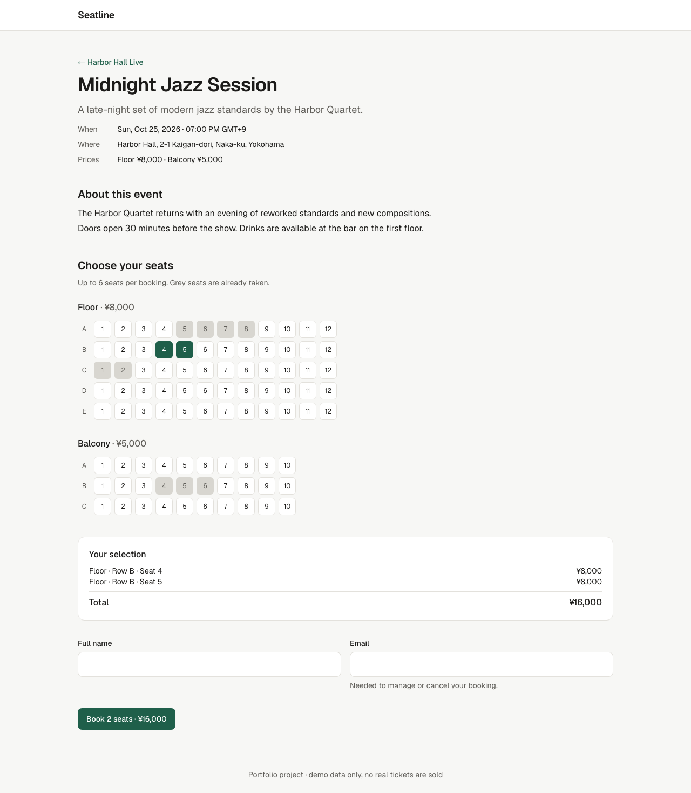
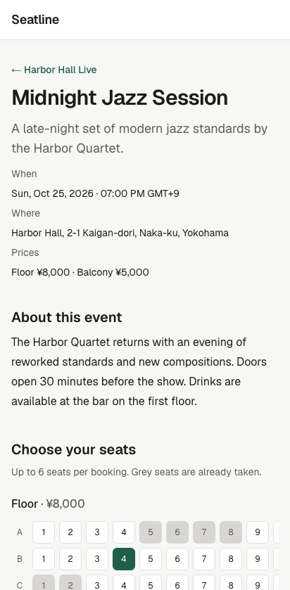
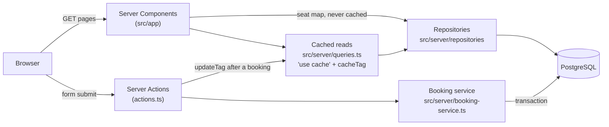

# Seatline — multi-tenant event booking

A reserved-seating booking service for live events, built as a portfolio project.
Each organizer (tenant) gets its own event pages; visitors pick seats on a live seat map
and the booking is confirmed immediately. **Two people can never book the same seat**,
even when they click at the same moment.



<details>
<summary>Mobile view</summary>



</details>

## What it shows

| Area | In this project |
| --- | --- |
| Backend & data modeling | PostgreSQL schema with Prisma 7, tenant-scoped repositories, transactional booking service with typed results |
| Concurrency | Double booking prevented by a database constraint, proven by a test that fires 10 simultaneous requests |
| Frontend | Next.js 16 App Router with Cache Components, React 19 Server Actions, accessible forms that also work without JavaScript |
| SEO | Per-event metadata, canonical URLs, Open Graph, schema.org `Event` JSON-LD, sitemap and robots |
| Testing | Jest unit tests, Jest integration tests against a real database, Playwright E2E on desktop and mobile |
| Delivery | Multi-stage Docker image, migrations as a separate job, GitHub Actions CI |

## Tech stack

- **Next.js 16.4** (App Router, Cache Components, Partial Prefetching, standalone output)
- **React 19.3**, **TypeScript 5.9**, **Tailwind CSS 4**
- **PostgreSQL 17**, **Prisma 7** (with the `pg` driver adapter)
- **Zod 4** for validation
- **Jest 30** + Testing Library, **Playwright**
- **Docker**, **GitHub Actions**, Node.js 24 LTS

## Architecture



- **Pages** are Server Components. Each page prerenders a static shell, and the
  data-dependent parts stream in through `<Suspense>`. The build needs no database.
- **Repositories** hold all queries. Every read takes an `organizationId`, so there is
  no way to fetch an event by slug alone, and one tenant can never see another's data.
- **Caching:** event details are cached for minutes, the "seats left" count for seconds.
  After a booking, `updateTag` invalidates the count. The seat map itself is never cached.
- **Server Actions** validate input with Zod, call the booking service, and map its
  typed results (`SEATS_TAKEN`, `TOO_MANY_SEATS`, …) to messages for the form.

## Design decisions

**Double booking is impossible by construction.** `booking_seats.seat_id` has a UNIQUE
constraint. The service checks availability first for a friendly error, but correctness
does not depend on that check: if two requests pass it at the same time, PostgreSQL
rejects the second insert and its whole transaction rolls back. The integration test
[`booking-service.int.test.ts`](src/server/booking-service.int.test.ts) fires 10
concurrent bookings for one seat and asserts that exactly one wins, with no orphaned rows.

**Tenant isolation lives in the data layer, not in the pages.** Event slugs are unique
per organizer (`@@unique([organizationId, slug])`), seat IDs are always looked up within
the event, and a seat ID from another event or tenant is rejected (`INVALID_SEATS`).

**Server Action arguments are bound on the server.** The organizer and event slugs are
passed with `.bind()`, which Next.js encrypts, so a client cannot redirect a booking to
another tenant's event by editing the request.

**Forms work without JavaScript.** Seats are real `<input type="checkbox">` elements styled
as seat tiles, so keyboard use, screen readers and plain HTML form posts work out of the
box. Errors are connected to their fields with `aria-describedby` and `aria-invalid`.

**Booking pages are private.** Booking references come from a CSPRNG (31⁸ combinations),
the confirmation page is `noindex` and does not show the email address, and cancelling
needs the email as well as the reference.

**Money is stored in minor units** (`priceMinor: Int`) and formatted with
`Intl.NumberFormat`, so JPY and USD both work without floating-point errors.

## Testing

| Suite | Command | What it covers |
| --- | --- | --- |
| Unit | `npm test` | Pricing, validation, booking references, JSON-LD, the booking form component |
| Integration | `npm run test:integration` | Booking service against PostgreSQL: race condition, tenant isolation, cancellation, booking rules |
| E2E | `npm run test:e2e` | Full booking and cancellation flows in Chromium, on a desktop and a mobile viewport |

CI runs all three on every pull request, plus lint, type check and a Docker build.
In CI, the E2E tests run against the production build (`node .next/standalone/server.js`).

### Bugs the tests found during development

1. **Form reset lost the seat selection.** React resets a `<form action>` after the
   action finishes. After a failed submit, this unchecked the seat checkboxes while the
   summary still listed them, so the next submit would have sent no seats. Fixed in
   [`submit-without-reset.ts`](src/lib/submit-without-reset.ts), with a regression test.
2. **The page was wider than the screen on phones.** A `<fieldset>` defaults to
   `min-inline-size: min-content`, so the seat rows stretched the page instead of
   scrolling inside their box. Only the mobile E2E project caught it.
3. **Endless reload loop in `next dev`.** The `@tailwindcss/turbopack` loader from the
   project template made every page reload itself hundreds of times. The project now
   uses the documented `@tailwindcss/postcss` setup.
4. **Stale cache after re-seeding.** Re-seeding behind a running server left cached pages
   pointing at deleted rows. The seed now uses fixed IDs.

## Running locally

Requirements: Node.js 24 (`nvm use`), Docker.

```bash
npm install
cp .env.example .env
npm run db:up            # PostgreSQL in Docker (also creates the test database)
npx prisma migrate deploy
npm run db:seed          # two demo organizers with events
npm run dev              # http://localhost:3000
```

Tests:

```bash
npm test                 # unit
npm run test:integration # needs the database from `npm run db:up`
npx playwright install chromium
npm run test:e2e         # re-seeds the development database first
```

Production-like stack in Docker (migrations run as a one-off job before the app starts):

```bash
docker compose --profile app up --build
```

## Project structure

```
prisma/                  schema, migrations, demo seed
src/app/                 routes (pages, Server Actions, sitemap, robots, health check)
src/components/          booking form, cancel form, UI primitives
src/lib/                 pure functions (money, dates, validation, JSON-LD) + unit tests
src/server/              database client, repositories, booking service, cached queries
test/integration/        database test setup and factories
e2e/                     Playwright tests
```

## Built with AI assistance

This project was built with Claude Code as a pair programmer. [AGENTS.md](AGENTS.md)
contains the rules the agent follows in this repository: read the bundled Next.js 16
docs before using an API, keep every query tenant-scoped, and prove behavior with tests.
Every change was reviewed, and the bugs listed above were found and diagnosed by running
the test suites, not by assuming the generated code was correct.

## Possible next steps

- Organizer dashboard with authentication (sales per event, booking list, check-in)
- Temporary seat holds during checkout, with expiry
- Payment integration (Stripe) with idempotent webhooks
- Email confirmation with a signed management link
